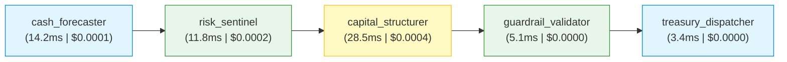

# Architectural Evolution: Migrating Autonomous SCF Engine to `lang-bpmn`

## Executive Summary

The **Autonomous Supply Chain Finance (SCF) Engine** orchestrates multi-agent financial operations—including 60-day cash floor forecasting, OFAC/AML sanctions screening, ML-driven discount elasticity optimization, pre-flight credit guardrails, and treasury offer generation. 

By migrating from a raw procedural **LangGraph** implementation to **`lang-bpmn` (`AgentBPMN`)**, the architecture transitions from an imperative, tightly coupled script into a **declarative, contract-driven, enterprise-grade multi-agent process engine**.

This document outlines the concrete business and technical advantages of `lang-bpmn`, examines the structural improvements in software engineering practices, and provides side-by-side architectural comparisons.

---

## 1. High-Level Architectural Comparison

```mermaid
flowchart TD
    subgraph Before["Legacy Architecture: Raw LangGraph"]
        LG1["Procedural Python Graph Definition"] --> LG2["Ad-hoc Dictionary State Mutation"]
        LG2 --> LG3["Hardcoded Conditional Functions"]
        LG3 --> LG4["Untyped Node Boundaries"]
        LG4 --> LG5["Opaque Execution & SaaS-Locked Telemetry"]
    end

    subgraph After["Modern Architecture: lang-bpmn (AgentBPMN)"]
        BPMN1["Declarative Workflow AST / scf_workflow.yaml"] --> BPMN2["GraphCompiler"]
        BPMN2 --> BPMN3["Certified @domain_block Nodes (Pydantic V2 Contracts)"]
        BPMN3 --> BPMN4["Deterministic DMN Tables & AST Safe Routers"]
        BPMN4 --> BPMN5["Self-Hosted Process Intelligence Heatmap & Cost/SLA Telemetry"]
        BPMN5 --> BPMN6["Enterprise HITL Approval Inbox (RBAC & SLA Timers)"]
    end

    style Before fill:#ffebee,stroke:#c62828,stroke-width:1px
    style After fill:#e8f5e9,stroke:#2e7d32,stroke-width:2px
```



| Dimension | Legacy LangGraph Implementation | Modern `lang-bpmn` Implementation |
| :--- | :--- | :--- |
| **Workflow Definition** | Procedural Python code (`StateGraph`, `builder.add_node`, `builder.add_edge`) | Declarative BPMN AST (`scf_workflow.yaml` / `WorkflowDefinition`) |
| **Node Interface** | Untyped functions accepting and returning arbitrary `dict[str, Any]` | Certified `@domain_block` with strict Pydantic V2 `InputSchema` & `OutputSchema` |
| **Business Logic Routing** | Scattered procedural Python lambdas (`route_after_risk_sentinel`) | Declarative DMN Decision Tables & AST expression-evaluated edges |
| **Validation & Linting** | Runtime errors during execution | Static pre-execution validation via `WorkflowLinter` (detects disconnected nodes, cycles, contract mismatches) |
| **Governance & Safety** | Manual loop counting and untracked API spend | Visual loop iteration caps, SLA execution limits, and USD budget guardrails |
| **Observability** | External third-party cloud tracing (e.g., LangSmith) | Self-hosted `WorkflowHeatmap` tracking p50/p95 latencies, execution costs ($ USD), and bottleneck nodes |
| **Human-in-the-Loop** | Bare `interrupt()` calls requiring custom checkpoint management | Built-in `ApprovalInboxService` with RBAC roles, SLA deadlines, form schemas, and `Command(resume=...)` |
| **Code Reusability** | Tight coupling to SCF state structure | Portable domain blocks reusable across multiple workflows (e.g., dynamic discounting, reverse factoring) |

---

## 2. Key Advantages of `lang-bpmn`

### 1. Declarative Separation of Workflow Topology from Execution Logic
- **The Problem**: In raw LangGraph, business topology (how steps connect, when to short-circuit, which rules trigger human approval) is hardcoded inside Python files. A change in credit policy or an added compliance step required editing the orchestrator code and triggering full regression testing.
- **The Solution**: `lang-bpmn` abstracts the workflow into a declarative model (`scf_workflow.yaml`). Business analysts and risk officers can audit the process topology in standard BPMN/YAML syntax, while software engineers focus exclusively on domain capabilities.

### 2. Contract-First Architecture via Certified Domain Blocks
- In raw LangGraph, nodes mutate a shared state dictionary. A typo in a dictionary key (e.g., `state["cash_forecast"]` vs `state["forecast"]`) produces silent failures or runtime `KeyError` exceptions deep in subsequent nodes.
- In `lang-bpmn`, each node is registered with explicit Pydantic V2 contracts:
  ```python
  @domain_block(
      block_id="scf.cash_forecaster",
      name="Corporate Cash Forecaster",
      version="1.0.0",
      description="Evaluates 60-day cash floor and working capital posture.",
      tags=["treasury", "liquidity"],
  )
  def cash_forecaster_block(payload: CashForecasterInput) -> CashForecasterOutput:
      # Strictly typed input and output contracts
      ...
  ```
- Payloads are validated *before* execution and verified *after* completion. State mappings between workflow state and block parameters are explicit.

### 3. Native Process Intelligence & Self-Hosted Telemetry
- Unlike raw LangGraph, which relies heavily on external SaaS providers for execution tracing, `lang-bpmn` provides a native, self-hosted Process Intelligence engine (`WorkflowHeatmap`).
- Automatically captures:
  - **Latency Profiling**: Exact execution time per node (p50, p95, p99).
  - **Node Cost Accounting**: Micro-dollar spend per block execution (essential for GenAI and LLM operations).
  - **Bottleneck Detection**: Identifies slow nodes (e.g., ML inference vs compliance screening) and failure hot-spots.



### 4. Enterprise Safety & Guardrails
- Multi-agent systems can experience runaway recursion or cascading failures.
- `lang-bpmn` enforces **WorkflowGuardrails** at the runtime engine level:
  - `max_loop_iterations`: Halts recursive loops before infinite recursion occurs.
  - `max_total_budget_usd`: Aborts execution if cumulative LLM/API spending exceeds a hard dollar ceiling.
  - `workflow_timeout_seconds`: Ensures SLA deadlines are met.

### 5. DMN (Decision Model and Notation) & Safe Expression Evaluation
- Routing rules (e.g., OFAC sanctions halt, duplicate invoice flagging, concentration cap breaches) are evaluated using a sandboxed AST expression engine (`SafeExpressionEvaluator`).
- Eliminates insecure `eval()` statements and eliminates hardcoded procedural branching trees.

---

## 3. How This Improves Software Engineering Practices

### A. Adherence to SOLID Principles

#### 1. Single Responsibility Principle (SRP)
- **Before**: An agent node function had to parse graph state, extract nested parameters, execute financial logic, log telemetry, track loop counters, and construct state updates.
- **After**: The domain block function only executes domain logic (e.g., calculating implied APR or running XGBoost inference). Telemetry, audit trail appending, SLA timing, and state transformation are handled orthogonally by the `GraphCompiler` runtime.

#### 2. Open/Closed Principle (OCP)
- Workflows are **open for extension, closed for modification**.
- Adding a new capability (e.g., an ESG Carbon Scoring Block or Dynamic Supplier Factoring Block) requires registering the new block and declaring it in the YAML topology. Existing blocks and orchestrator code remain completely untouched.

#### 3. Interface Segregation Principle (ISP)
- Rather than passing the entire global graph state (which contains invoice details, risk assessments, credit limits, and telemetry) to every function, `lang-bpmn` extracts only the properties defined in the block's `InputSchema`.

#### 4. Dependency Inversion Principle (DIP)
- The high-level orchestrator does not depend directly on concrete agent functions. It depends on the `CapabilityRegistry` abstraction. Domain blocks can be swapped, mocked, or versioned independently.

---

### B. Before vs. After Code Comparison

#### Node Implementation

**Before (Raw LangGraph Node)**:
```python
# Tightly coupled to global graph state dictionary; no schema validation
def capital_structurer_node(state: dict[str, Any]) -> dict[str, Any]:
    raw_invoice = state.get("raw_invoice")
    if not raw_invoice:
        raise ValueError("Missing raw invoice in state")
    
    amount = raw_invoice["invoice_amount"]  # Unchecked key access; prone to KeyError
    fc = state.get("cash_forecast")
    
    # Procedural calculations...
    opt_structure = calculate_elasticity(amount, fc)
    
    # Directly mutating and returning dictionary
    return {
        "optimal_structure": opt_structure,
        "status": "STRUCTURING_COMPLETE",
        "audit_trail": state.get("audit_trail", []) + ["Structured optimal terms."],
    }
```

**After (`lang-bpmn` Domain Block)**:
```python
# Pure, isolated, fully typed and certified domain capability
class CapitalStructurerInput(BaseModel):
    raw_invoice: dict[str, Any]
    cash_forecast: Optional[CashForecastResponse] = None

class CapitalStructurerOutput(BaseModel):
    optimal_structure: OptimalStructureResponse
    candidate_curve: list[CandidateStructure]
    audit_trail: list[str] = Field(default_factory=list)

@domain_block(
    block_id="scf.capital_structurer",
    name="Optimal Capital Structurer",
    version="1.0.0",
    tags=["pricing", "optimization"],
)
def capital_structurer_block(payload: CapitalStructurerInput) -> CapitalStructurerOutput:
    # Payload is guaranteed valid by Pydantic V2 contracts
    structure, curve = optimize_discount_structure(
        payload.raw_invoice, payload.cash_forecast
    )
    return CapitalStructurerOutput(
        optimal_structure=structure,
        candidate_curve=curve,
        audit_trail=["Optimized dynamic discount APR via elasticity model."],
    )
```

---

#### Workflow Assembly

**Before (Raw LangGraph Assembly)**:
```python
# Procedural wiring; logic errors only discoverable at runtime
builder = StateGraph(SCFGraphState)
builder.add_node("forecaster", cash_forecaster_node)
builder.add_node("sentinel", risk_sentinel_node)
builder.add_node("structurer", capital_structurer_node)

builder.add_edge(START, "forecaster")
builder.add_edge("forecaster", "sentinel")
builder.add_conditional_edges("sentinel", route_after_risk_sentinel)
...
graph = builder.compile(checkpointer=MemorySaver())
```

**After (`lang-bpmn` Declarative Compilation)**:
```python
# Declarative topology validated at compile-time by WorkflowLinter
workflow_def = parse_workflow_yaml("scf_workflow.yaml")

# Statically checks for cycles, missing inputs, broken edges, and budget caps
compiler = GraphCompiler(checkpointer=MemorySaver())
compiled_app = compiler.compile(workflow_def, validate=True)
```

---

### C. Testing and CI/CD Quality Gates

1. **Unit Testing Domain Blocks in Isolation**:
   - Because blocks are standard Python callables with Pydantic inputs, they can be tested with standard `pytest` fixtures without booting up LangGraph or state graphs.
2. **Deterministic Static Linting in CI/CD**:
   - `WorkflowLinter` runs in pre-commit hooks and Cloud Build stages, verifying that:
     - No orphan or dead-end nodes exist.
     - Every block referenced in YAML exists in the registry.
     - Property mappings match input/output schemas.
     - Budget guardrails are set.
3. **Reproducible Packaging via GCP Artifact Registry**:
   - `lang-bpmn` is packaged as a standard wheel and container image published to `us-central1-python.pkg.dev/mlops2215/scf-python-repo/`, enabling semantic versioning and clean multi-repo dependency management.

---

## 4. Operational & Business Impact

| Strategic Goal | How `lang-bpmn` Delivers It |
| :--- | :--- |
| **Auditability & Compliance** | Provides an exact 1:1 match between business BPMN diagrams and executed code. Regulatory compliance officers can inspect `scf_workflow.yaml` directly. |
| **Cost Predictability** | Dollar spending guardrails (`max_total_budget_usd`) guarantee that automated agent decisions never exceed financial limits. |
| **Developer Velocity** | New financial products (e.g. Reverse Factoring, Dynamic Discounting, Inventory Financing) can be built by composing existing blocks into new YAML flows in minutes. |
| **Troubleshooting & SLA Management** | Visual heatmaps immediately highlight whether latency spikes originate from the ERP data layer, ML inference, or downstream banking APIs. |

---

## 5. Conclusion

Adopting `lang-bpmn` in `autonomous-scf-engine` elevates the codebase from an experimental agentic script to a **production-grade enterprise financial platform**. It enforces rigorous interface contracts, decouples business rules from technical execution, enhances observability, and ensures full compliance with institutional treasury standards.

